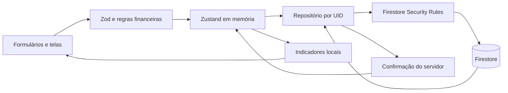

# Arquitetura

## Decisão validada

Frontend estático React/JavaScript, Vite e HashRouter. Firebase Authentication e Cloud Firestore são serviços gerenciados acessados diretamente pelo SDK; não há servidor Node persistente. O Node é ferramenta de desenvolvimento/build/testes. O artefato de produção é `dist/`, compatível com subdiretório e GitHub Pages.

Regras financeiras independentes da interface em `features/financial-health/engine.js`, `features/goals/calculations.js`, `features/transactions/operations.js` e `utils/`. Valores monetários em inteiros de centavos. Fontes de verdade: documentos privados de conta e lançamentos confirmados. Reservas/objetivos alocam saldos já existentes. Avaliações de investimentos são ajustes na conta de investimento.

## Camadas

| Camada                 | Local                                                     | Responsabilidade                                                          |
| ---------------------- | --------------------------------------------------------- | ------------------------------------------------------------------------- |
| Entrada                | `app/` e `main.jsx`                                       | Rotas, providers, layout, períodos e error boundary                       |
| Apresentação           | `features/*/*.jsx`, `components/`                         | Telas, formulários, gráficos e estados vazios                             |
| Domínio                | `engine.js`, `calculations.js`, `operations.js`, `utils/` | Saldos, competências, projeções, simulações e validações                  |
| Estado                 | `store/useFinance.js`                                     | Dados em memória, limitação de gravações concorrentes, descarte no logout |
| Persistência           | `services/repositories/`                                  | Consultas por UID, paginação, transações e revisões                       |
| Serviços locais        | `services/importers/`, `services/exporters/`              | Leitura de arquivos, normalização, fingerprints, criptografia e downloads |
| Fronteira de segurança | `firestore.rules`                                         | Autorização real, schemas, proprietário, revisões e casal                 |

## Fluxo de dados

Gravações têm revisão esperada e confirmação do servidor antes da atualização do estado. Leituras iniciais são paginadas por ID em blocos de 200; os registros são reunidos em memória para cálculos completos. Nenhuma consulta global de usuários. Depois de gravar, aplicam-se apenas os documentos confirmados, sem recarregar toda a coleção. Atualização manual recupera mudanças de outras sessões; conflitos são recusados por revisão.

## Concorrência e idempotência

Transações Firestore leem as revisões antes de escrever. `createOnly` impede recriar IDs. Parcelas e recorrências têm IDs determinísticos dentro de um grupo; importações usam SHA-256 com instituição/conta/data/valor/ID bancário ou descrição normalizada. Restauração preserva IDs. O bloqueio `busy` impede duas gravações simultâneas na mesma sessão. Restaurações/importações grandes são divididas em lotes e relatam progresso parcial em caso de falha; não há atomicidade entre lotes.

## Privacidade e PWA

Firestore usa `memoryLocalCache()`. O service worker guarda somente recursos estáticos, sem estratégia de cache para Firebase. HashRouter evita fallback de rotas no Pages. O build usa o mesmo `base` no HTML, manifest e service worker. Atualizações PWA pedem ação explícita antes de recarregar a aplicação.

Cada sessão tem um contador de geração; respostas atrasadas de uma sessão encerrada não podem repovoar o store de outro usuário. Dados do casal residem fora de `users/{uid}`. Locks bilaterais e consentimento qualitativo são descritos em SECURITY.md.

## Limites de escala e operação

O carregamento inicial ainda percorre todo o histórico privado em páginas, adequado a poucos usuários com milhares de documentos. Para históricos maiores, implementar snapshots mensais confiáveis e consultas por janelas antes de ampliar uso. Não há listener em cada gráfico/render. As bibliotecas de Excel/PDF são grandes, mas importadas sob demanda; essa divisão não elimina o custo quando o usuário abre esses formatos.

Não há monitor de cota global no navegador: o Console Firebase é a fonte oficial. Contadores de sessão omitem leituras das regras, falhas, outros dispositivos e parte do fluxo casal. Não há sistema externo de telemetria.

## Fontes oficiais consultadas em 28/10/2026

- [Hospedagem estática e base do Vite](https://vite.dev/guide/static-deploy.html)
- [Preços Firebase](https://firebase.google.com/pricing)
- [Cotas Firestore](https://firebase.google.com/docs/firestore/quotas)
- [Condições das Security Rules](https://firebase.google.com/docs/firestore/security/rules-conditions)
- [Emulator Suite](https://firebase.google.com/docs/emulator-suite/install_and_configure)
- [Atualizações controladas PWA](https://vite-pwa-org.netlify.app/guide/prompt-for-update.html)

O plano Spark tem cotas, não custo zero ilimitado. Não se utiliza Storage, Functions, SMS, PITR, TTL nem backups gerenciados. A compatibilidade técnica do build com Pages foi validada localmente; os [termos e limites de uso de Pages](https://docs.github.com/en/pages/getting-started-with-github-pages/github-pages-limits) exigem avaliação do proprietário antes de uso real, especialmente em aplicações com login. Não se presume que compatibilidade técnica seja autorização de uso comercial.
